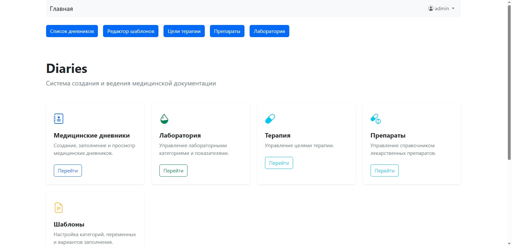
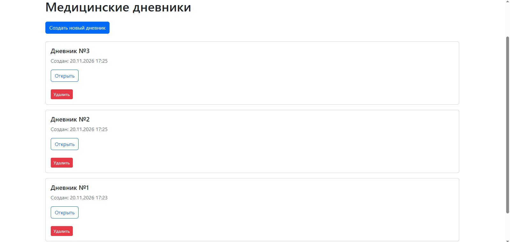
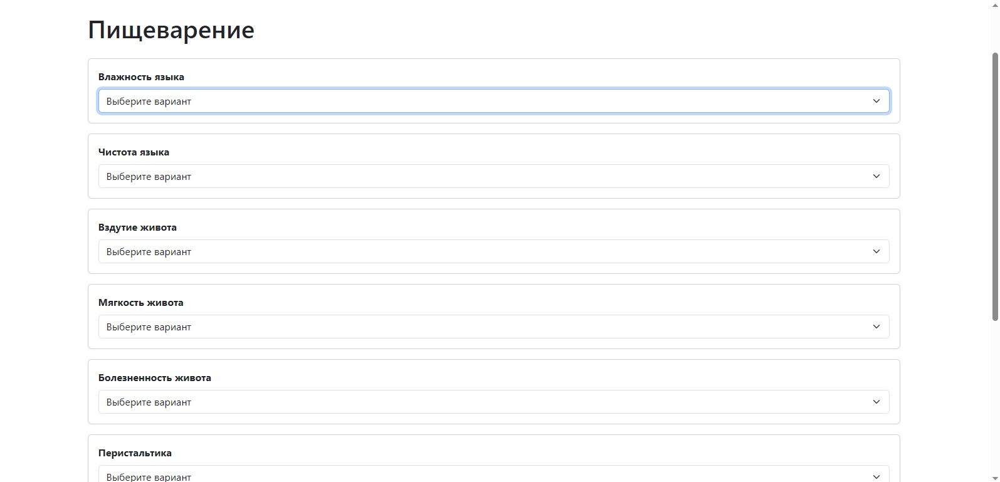
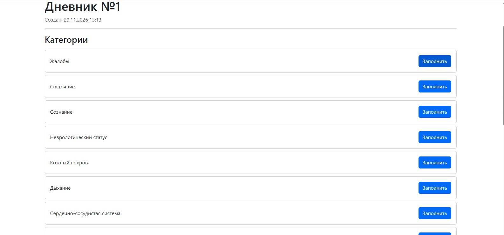
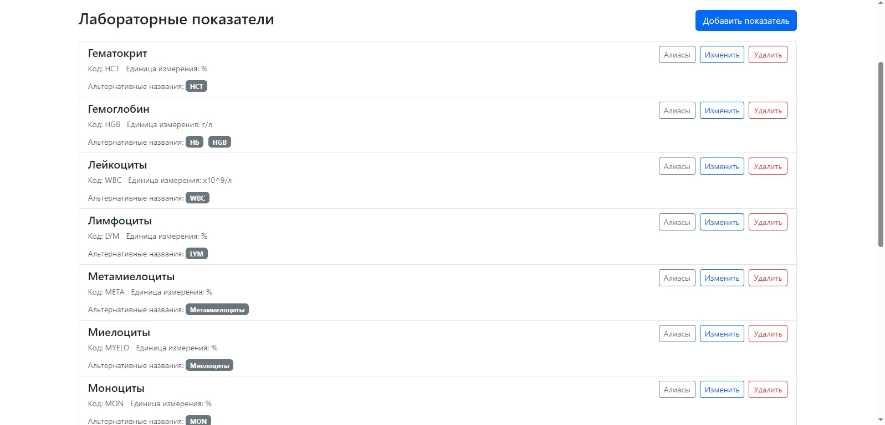
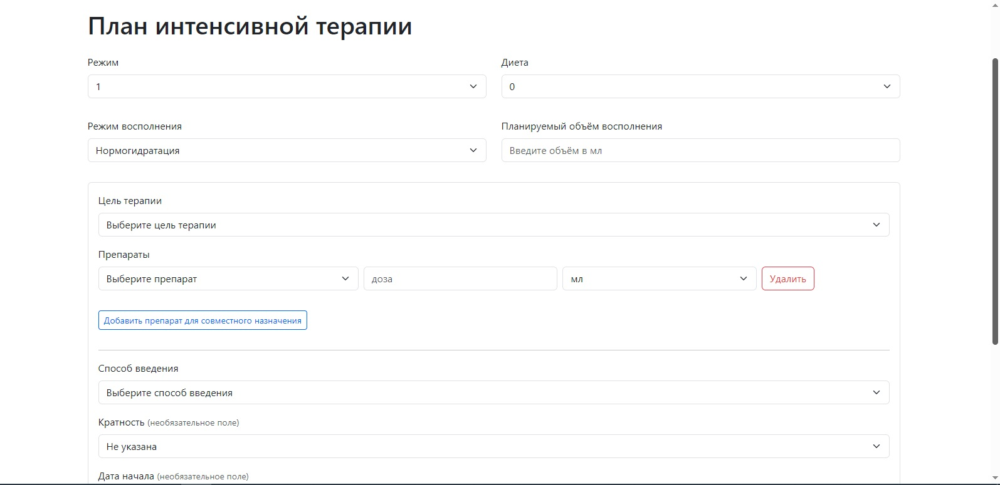

# Diaries

**Diaries** — веб-приложение на Flask для создания и ведения медицинских дневников.

Проект предназначен для упрощения оформления медицинской документации за счёт использования шаблонов, справочников и автоматического формирования текстовых записей.

## Возможности

- **Управление пользователями** — регистрация и авторизация.
- **Медицинские дневники** — создание, заполнение и просмотр записей.
- **Шаблоны записей** — создание категорий, переменных и вариантов заполнения.
- **Автоматическое формирование текста** — подстановка выбранных значений в шаблоны.
- **Терапия** — ведение справочников целей терапии, групп и лекарственных препаратов.
- **Лабораторные исследования** — справочники лабораторных показателей, источников и алиасов, обработка лабораторных результатов.


## !!!! ВАЖНО !!!!!
    На текущем этапе разработки генерации динамики лабораторных показателей происходит только из 
    текста взятого из медицинской информационной системы КМИС. Адекватная работа с другими исходными
    данными не гарантирована.

## Технологии

- Python
- Flask
- Flask-SQLAlchemy
- SQLAlchemy
- Flask-Migrate / Alembic
- Flask-Login
- Flask-WTF
- SQLite
- Bootstrap 5
- Pytest

## Структура проекта

```text
diaries_app/
│
├── app/
│   ├── routes/          # Маршруты приложения
│   ├── services/        # Бизнес-логика
│   ├── templates/       # HTML-шаблоны
│   ├── tests/           # Автоматизированные тесты
│   ├── decorators.py
│   ├── extensions.py
│   ├── forms.py
│   └── models.py
│
├── laboratory/
│   ├── templates/       # Шаблоны лабораторного модуля
│   ├── forms.py
│   ├── models.py
│   ├── parser.py
│   ├── routes.py
│   └── services.py
│
├── instance/            # База данных SQLite
├── migrations/          # Миграции базы данных
│
├── config.py
├── requirements.txt
├── run.py
├── .env.example
└── README.md
```

## Установка и запуск

### 1. Клонирование репозитория

```bash
git clone https://github.com/sashkaryzhik1908-netizen/diaries_app.git
```

Перейдите в папку проекта:

```bash
cd diaries_app
```

### 2. Создание виртуального окружения

```bash
python -m venv venv
```

Активация в Windows:

```bash
venv\Scripts\activate
```

### 3. Установка зависимостей

```bash
pip install -r requirements.txt
```

### 4. Настройка переменных окружения

Создайте файл `.env` в корне проекта на основе `.env.example`.

Сгенерируйте собственный секретный ключ:

```bash
python -c "import secrets; print(secrets.token_hex(32))"
```

Укажите его в `.env`:

```env
SECRET_KEY=your-generated-secret-key
FLASK_DEBUG=false
```

Не публикуйте файл `.env` и не передавайте свой секретный ключ другим пользователям.

### 5. Подготовка базы данных

В репозитории находится начальная база SQLite с предварительно заполненными справочниками и шаблонами.

Для применения миграций выполните:

```bash
flask --app run db upgrade
```

### 6. Запуск приложения

```bash
python run.py
```

После запуска приложение будет доступно по адресу:

http://127.0.0.1:5000

## Тестирование

Для запуска автоматизированных тестов:

```bash
python -m pytest -v
```

Для запуска тестов с измерением покрытия:

```bash
python -m pytest --cov=app --cov=laboratory
```

## База данных

В проекте используется SQLite. Изменения структуры базы данных управляются с помощью Flask-Migrate и Alembic.

Начальная база данных содержит предварительно заполненные справочники и шаблоны, необходимые для ознакомления с функциональностью приложения.

После клонирования репозитория пользователь получает собственную локальную копию базы данных. Изменения в ней не влияют на исходную базу в GitHub.

## Аккаунт администратора

Для ознакомления с полным функционалом приложения используйте данные для входа:

- **Логин:** `admin`
- **Пароль:** `admin`

## Статус проекта

Проект находится в разработке. Функциональность постепенно расширяется и совершенствуется.

---

## Скриншоты

### Главная страница


### Список дневников


### Заполнение дневника



### Лабораторный модуль


### Назначения препаратов



**Автор:** [sashkaryzhik1908-netizen](https://github.com/sashkaryzhik1908-netizen)